<div align="center">

# EXPAI Inference Platform

**Plataforma modular de inferencia de visión artificial en tiempo real para entornos industriales.**

[](https://www.python.org/)
[](https://fastapi.tiangolo.com/)
[](https://docs.ultralytics.com/)
[](https://pytorch.org/)
[](https://opencv.org/)
[](https://docs.docker.com/)
[](https://cloud.google.com/)
[]()

</div>

---

## Arquitectura

<div align="center">

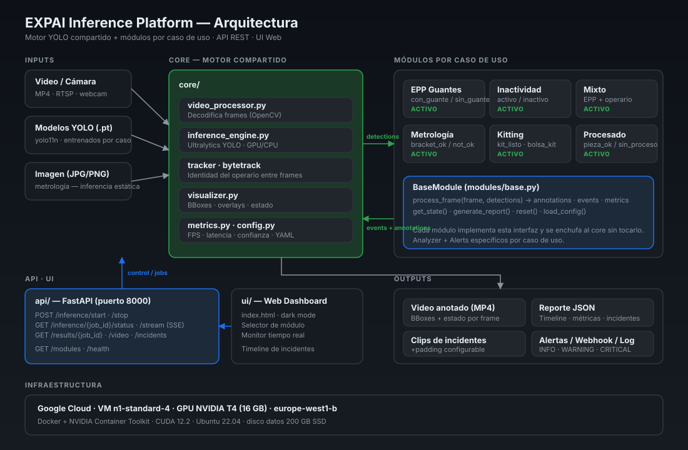

</div>

Un **core** compartido maneja decodificación de vídeo, inferencia YOLO, tracking y renderizado. Cada **módulo** implementa `BaseModule` y aporta la lógica específica del caso de uso (análisis, métricas, alertas). La **API FastAPI** orquesta jobs de inferencia y la **UI** expone los resultados en tiempo real.

---

## Módulos

| Módulo        | Estado    | Clases YOLO                                       | Salida principal                        |
|---------------|-----------|---------------------------------------------------|-----------------------------------------|
| **EPP Guantes**  | 🟢 Activo | `con_guante`, `sin_guante`                        | Alertas · % cumplimiento · incidentes   |
| **Inactividad**  | 🟢 Activo | `estado_activo`, `estado_inactivo`, `preparacion`, `descarga` | Tasa actividad · timeline inactividad   |
| **Mixto**        | 🟢 Activo | EPP + estados de operario                        | Correlación guantes ↔ actividad         |
| **Metrología**   | 🟢 Activo | `bracket_ok`, `bracket_not_ok`                   | Veredicto CONFORME / NO CONFORME        |
| **Kitting**      | 🟢 Activo | `operario`, `bolsa_kit`, `kit_listo`, `hoja_etiquetas` | Conteo kits/min · kits/hora            |
| **Procesado**    | 🟢 Activo | `pieza_ok`, `pieza_sin_proceso`                  | Conteo piezas · ritmo producción        |

---

## Stack

- **Inferencia** — Ultralytics YOLOv11 (`.pt`), PyTorch + CUDA 12.2, ByteTrack para tracking
- **Vídeo** — OpenCV (headless), lectura frame-a-frame de MP4 / RTSP
- **API** — FastAPI + Uvicorn, SSE para streaming de detecciones
- **UI** — HTML + CSS dark-mode, consumiendo la API
- **Infra** — GCP VM `n1-standard-4` · GPU **NVIDIA T4 (16 GB)** · Docker + NVIDIA Container Toolkit · Ubuntu 22.04

---

## Rendimiento observado

Medido sobre vídeos reales de planta (cámara fisheye 1920×1080) con `yolo11n` en GPU T4:

| Métrica               | Valor         |
|-----------------------|---------------|
| Throughput inferencia | **~26.6 FPS** |
| Frames procesados (sesión EPP) | 14 550 (9 min 42 s) |
| Cumplimiento EPP      | 68 %          |
| Incidentes EPP detectados | 5 (duración media 38.8 s) |
| Tasa actividad (sesión inactividad, 14 min) | 74 % |
| Kits/min (kitting)    | 20.0 (≈ 1 200 kits/h) |

---

## Módulo EPP — Guantes

Detección frame-a-frame de guantes de seguridad, análisis de transiciones `con_guante ↔ sin_guante`, generación de alertas por umbral de frames consecutivos y clips de incidentes.

<div align="center">

| Inferencia — compliant | Inferencia — violación |
|:---:|:---:|
| 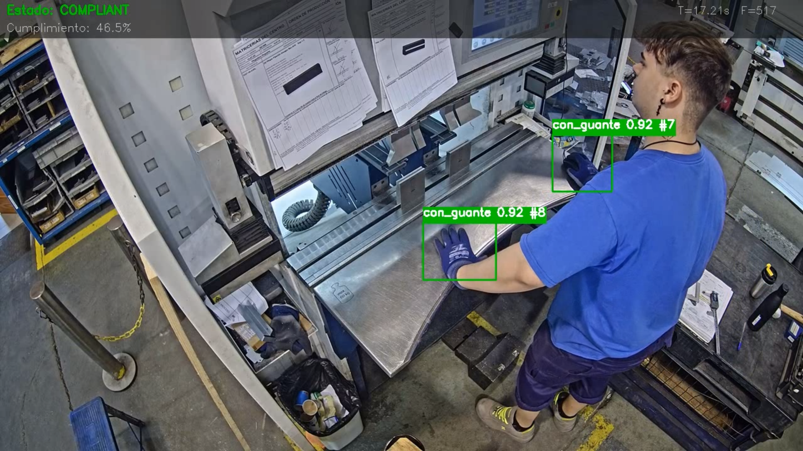 | 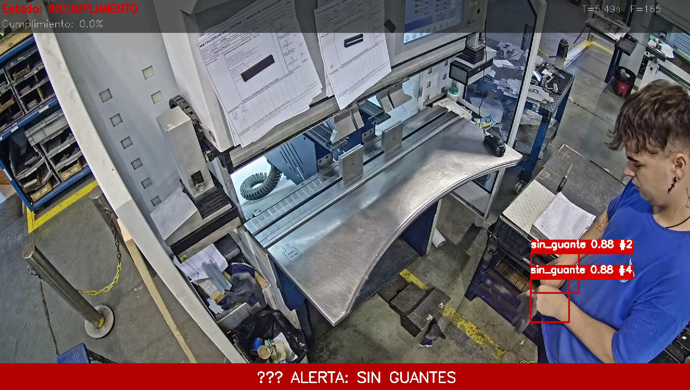 |
| `con_guante 0.92` — estado **COMPLIANT** | `sin_guante 0.88` — alerta **SIN GUANTES** |

</div>

**UI — monitor en tiempo real y reporte de sesión:**

<div align="center">

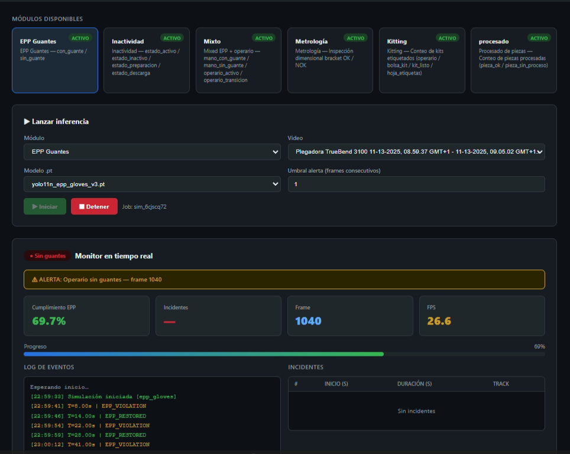
<sub>Monitor en vivo: cumplimiento, FPS, log de eventos y lista de incidentes.</sub>

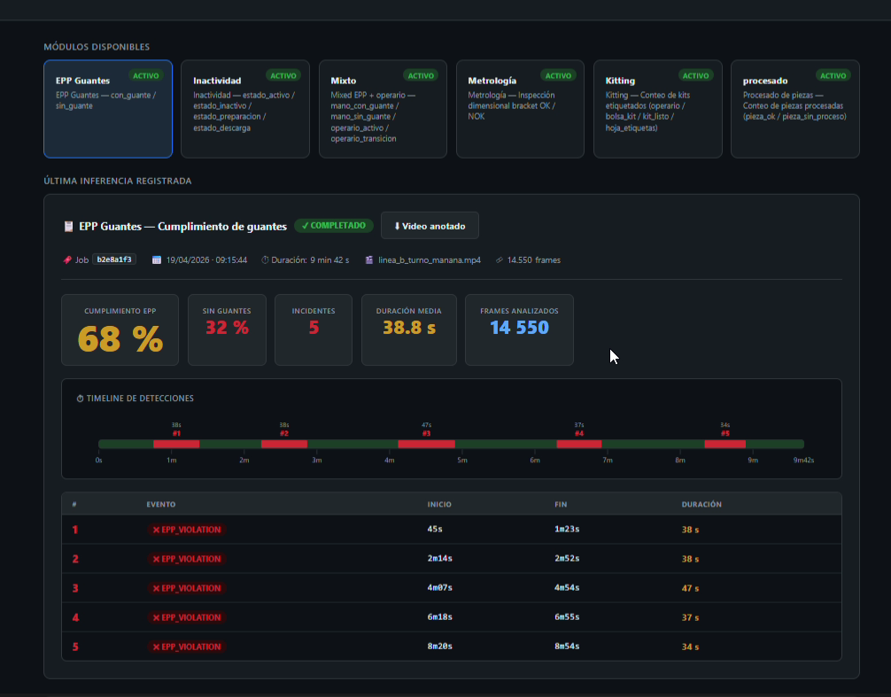
<sub>Reporte post-inferencia: KPIs, timeline de violaciones y tabla de eventos.</sub>

</div>

---

## Módulo Inactividad

Clasifica el estado del operario frame a frame (`activo`, `inactivo`, `preparacion`, `descarga`), acumula tiempos y detecta intervalos de inactividad por encima del umbral.

<div align="center">

| Operario activo | Operario inactivo |
|:---:|:---:|
|  |  |

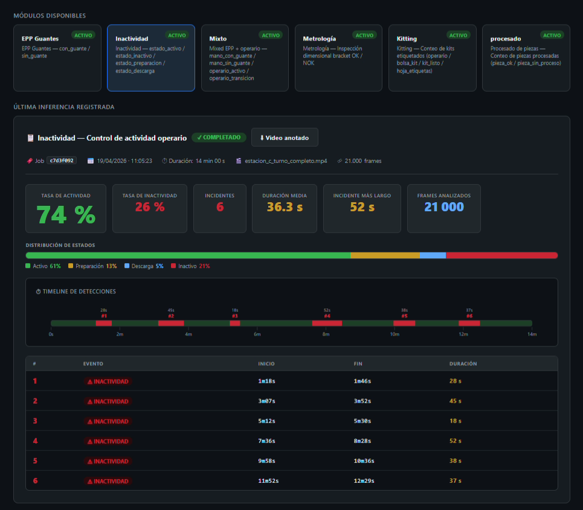
<sub>74 % actividad · 6 incidentes · incidente más largo 52 s · distribución por estado.</sub>

</div>

---

## Módulo Metrología

Inspección dimensional de piezas (bracket) a partir de imagen estática. Clasificador binario con doble umbral (`detección` / `NOK`) y veredicto CONFORME / NO CONFORME.

<div align="center">

| CONFORME | NO CONFORME |
|:---:|:---:|
| 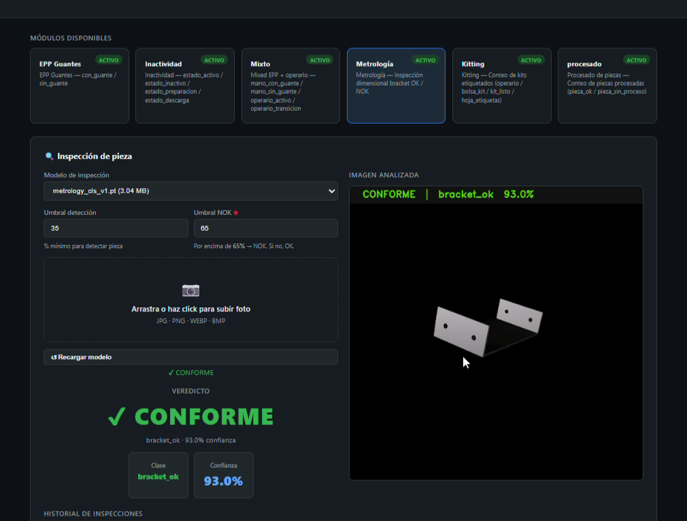 | 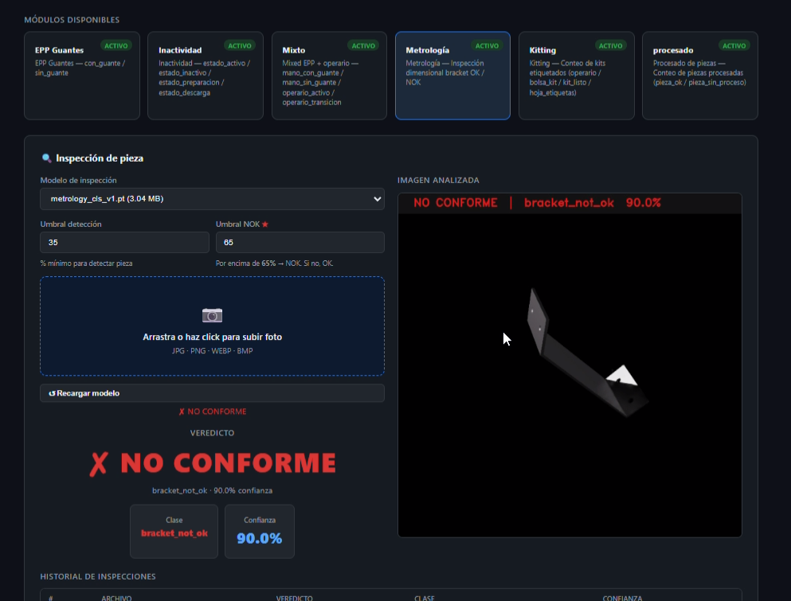 |

</div>

---

## Módulo Kitting

Conteo en tiempo real de kits etiquetados en la estación. Métricas de ritmo (kits/min, kits/hora) y timeline de kits completados con `track_id` del operario.

<div align="center">

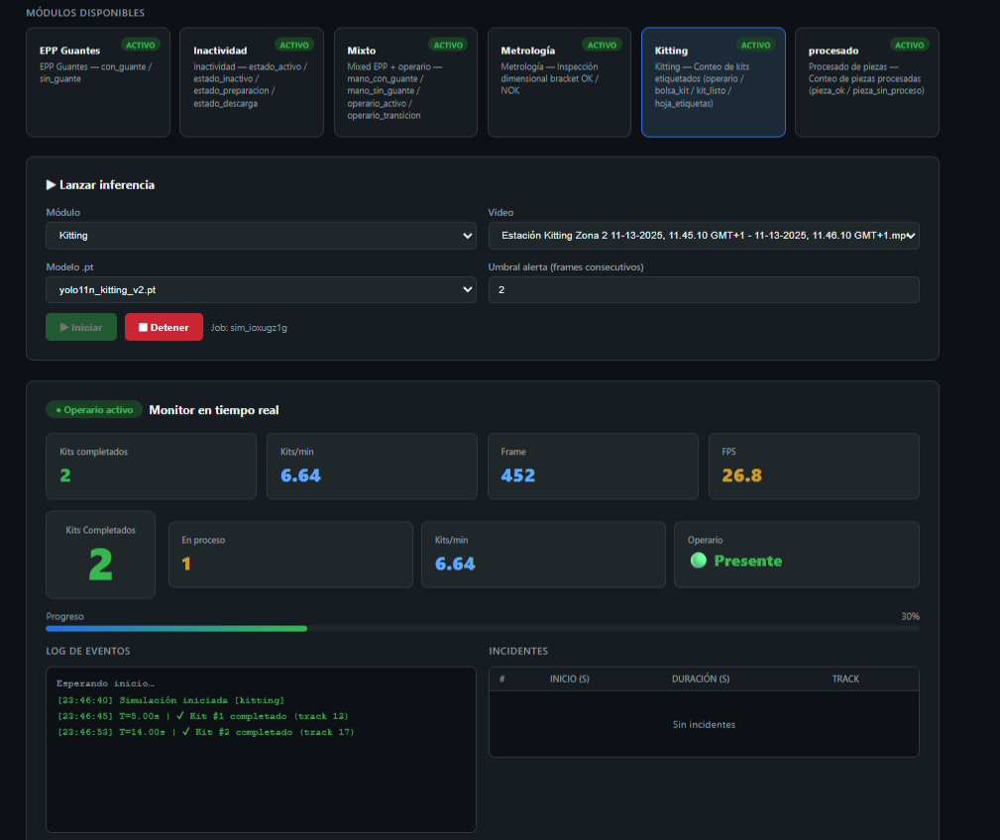
<sub>Monitor en vivo — 26.6 FPS, operario presente, kits acumulados.</sub>

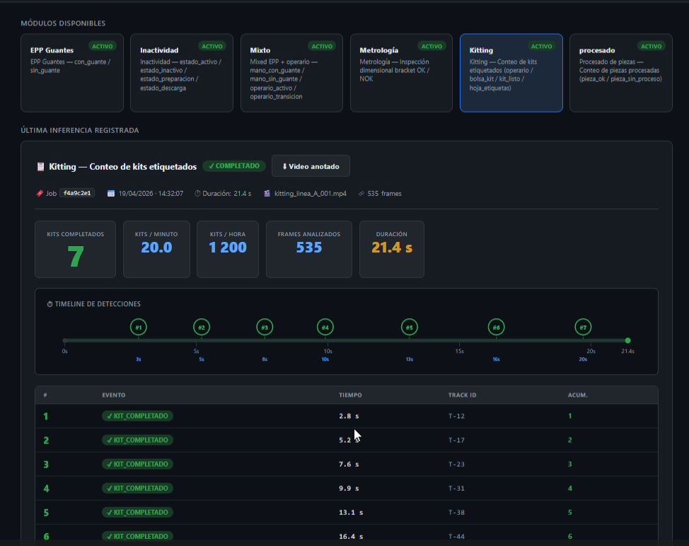
<sub>Reporte final — 7 kits en 21.4 s · 20 kits/min · 1200 kits/hora.</sub>

</div>

---

## Módulo Procesado

Conteo de piezas procesadas en plegadora (`pieza_ok` / `pieza_sin_proceso`), con ritmo de producción y estado de acumulación.

<div align="center">

| Inferencia sobre vídeo | UI — monitor tiempo real |
|:---:|:---:|
| 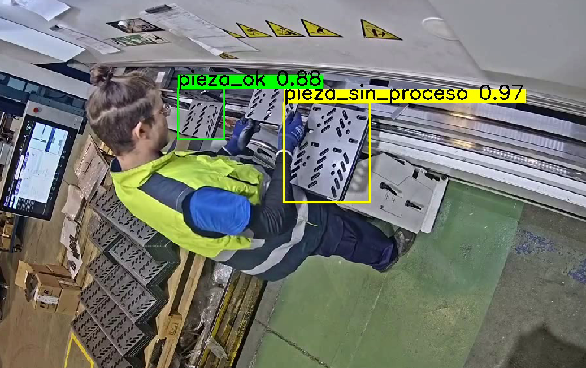 | 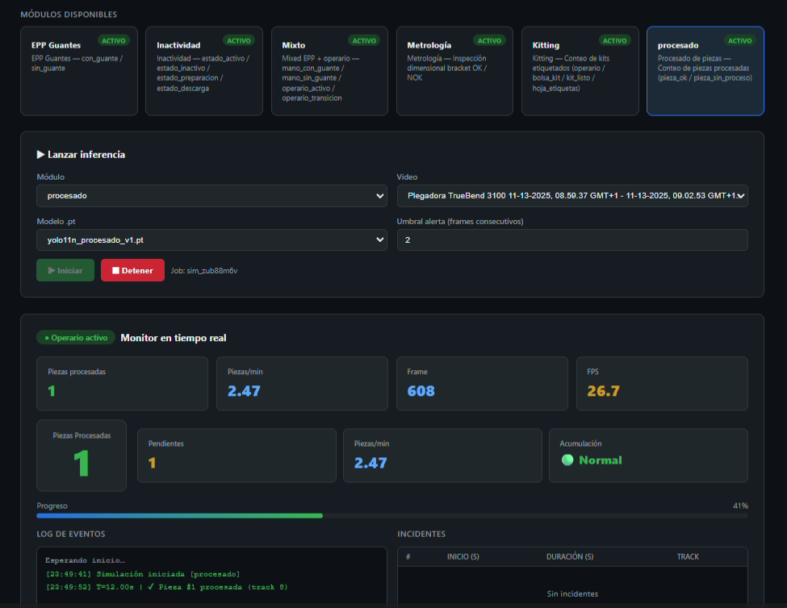 |

</div>

---

## Estructura del repositorio

```
expai-inference-platform/
├── core/                   # Motor de inferencia compartido (YOLO, video, tracking, viz, metrics)
├── modules/                # Módulos por caso de uso
│   ├── base.py             # Interfaz BaseModule
│   ├── epp_gloves/
│   ├── inactivity/
│   ├── mixed/
│   ├── metrology/
│   ├── kitting/
│   ├── procesado/
│   └── assembly/
├── api/                    # FastAPI — endpoints de control, streaming y resultados
├── ui/                     # Dashboard web (HTML + CSS dark mode)
├── models/                 # Pesos YOLO (.pt) por módulo
├── videos/                 # Vídeos de entrada
├── outputs/                # annotated_videos/ · reports/ · logs/
├── docs/images/            # Diagrama + capturas (este README)
├── tests/
├── Dockerfile
├── docker-compose.yml
├── requirements.txt
├── setup_vm.sh
└── main.py                 # CLI directo (sin API)
```

---

## Instalación rápida

### Opción A — Docker (recomendado, GPU)

```bash
git clone https://github.com/alexxcode/expai-inference-platform.git
cd expai-inference-platform
docker compose up --build
# API en http://localhost:8000  ·  UI en ui/index.html
```

### Opción B — Python local

```bash
python3.11 -m venv .venv
source .venv/bin/activate         # Windows: .venv\Scripts\activate
pip install -r requirements.txt
uvicorn api.main:app --host 0.0.0.0 --port 8000
```

### Lanzar una inferencia

```bash
curl -X POST http://localhost:8000/inference/start \
  -H "Content-Type: application/json" \
  -d '{
    "module": "epp_gloves",
    "video_path": "videos/linea_b_turno_manana.mp4",
    "model_path": "models/yolo11n_epp_gloves_v3.pt"
  }'
```

---

## Infra GCP

VM provisionada con GPU T4 en `europe-west1-b`. El script `setup_vm.sh` cubre drivers NVIDIA, CUDA 12.2, Docker y NVIDIA Container Toolkit. Especificación completa y comandos `gcloud` en [`README_EXPAI_INFERENCE_PLATFORM.md`](README_EXPAI_INFERENCE_PLATFORM.md).

---

## Endpoints API

| Método | Endpoint                        | Descripción                                   |
|--------|---------------------------------|-----------------------------------------------|
| GET    | `/health`                       | Health check                                  |
| GET    | `/modules`                      | Lista módulos disponibles                     |
| POST   | `/inference/start`              | Arranca inferencia (módulo + vídeo + modelo)  |
| GET    | `/inference/{job_id}/status`    | Estado del job                                |
| GET    | `/inference/{job_id}/stream`    | SSE de detecciones en tiempo real             |
| POST   | `/inference/{job_id}/stop`      | Detiene inferencia                            |
| GET    | `/results/{job_id}`             | Reporte completo (JSON)                       |
| GET    | `/results/{job_id}/video`       | Vídeo anotado                                 |
| GET    | `/results/{job_id}/incidents`   | Lista de incidentes                           |

---

## Documentación adicional

- [`README_EXPAI_INFERENCE_PLATFORM.md`](README_EXPAI_INFERENCE_PLATFORM.md) — especificación técnica completa, configuración por módulo, provisioning GCP paso a paso.
